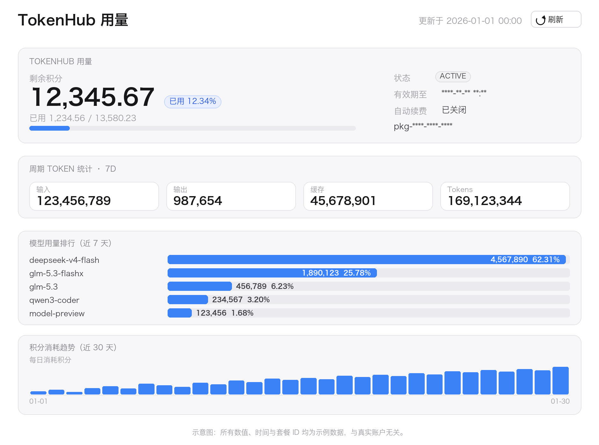

# dsh-tokenhub-usage

在 DSH Web GUI 侧边栏新增 **TokenHub 用量** 面板，可视化腾讯云 TokenHub 个人套餐的用量。



> 上图为示意图：数值、时间与套餐 ID 均为示例数据，不是真实账户截图。

## 功能

- **积分总览** —— 总积分 / 已用 / 剩余进度条、已用百分比（两位小数；超支按实际显示 >100%，进度条封顶；极小占比显示 `<0.01%`）、套餐状态、有效期、自动续费
- **Token 统计** —— 近 7 天输入 / 输出 / 缓存 / 总 token
- **模型排行** —— 近 7 天按模型维度的 token 条形图与占比
- **积分趋势** —— 近 30 天每日柱状图；**今天的柱子为橙色**，实时累计今日已用（CLI 日序列只含已完成的天，插件按「套餐已用总量 − 已完成日之和」补出今天）
- **最近调用** —— 逐次请求的时间、模型、token 拆分与积分消耗
- 每 2 分钟自动刷新，也可手动刷新
- **秒开** —— 快照缓存在浏览器模块作用域，切回面板直接渲染，随后后台静默校验

## 依赖

- DSH 客户端 `>= 0.2.1-rc.5`
- TokenHub CLI：`npm i -g tencent-tokenhub-cli`，然后 `th auth login`

`th` 查找顺序（命中即用）：`DSH_TOKENHUB_TH` → `~/.local/bin/th` → `/usr/local/bin/th` → `/opt/homebrew/bin/th` → `/opt/local/bin/th` → `$PATH`。

## 安装

在 DSH「设置 → 插件 → 安装」中选择 **Git 仓库**，粘贴：

```
https://github.com/zacharyhli/DeepSeek-Harness#path:/plugins/dsh-tokenhub-usage
```

点「立即启用」后重启 DSH。仓库公开，安装时匿名 `git clone` 即可，无需 GitHub 账号或 token。

> `#path:` 不能省：仓库根不是 npm 包，安装器靠它定位子目录。浏览器地址栏里的 `…/tree/main/...` 不能用于安装。

### 其他方式

| 方式 | 做法 | 适用 |
| --- | --- | --- |
| **Git 仓库**（推荐） | 见上 | 一键安装、可升级 |
| 压缩包 | `npm pack` 得到 `dsh-tokenhub-usage-<版本>.tgz`，拷到目标机器安装 | 内网 / 无外网 |
| 本地目录 | 拷贝本目录（不带 `node_modules`），安装时选本地目录 | 边改边用 |
| npm 包名 | 发布到 npm / 内网源后，直接填 `dsh-tokenhub-usage` | 多人复用 |

## 开发

```bash
cd ~/.dsh/profiles/desktop
pnpm add file:<本目录绝对路径>
```

再把 `dsh-tokenhub-usage` 加入该 profile `package.json` 的 `dsh.profile.bundles`，重启 DSH。

> 改代码后需 `pnpm remove dsh-tokenhub-usage && pnpm add file:<目录>` 再重启：pnpm 对同版本 `file:` 依赖会复用旧拷贝。

## 结构

| 文件 | 作用 |
| --- | --- |
| `lib/index.js` | Host 半：注册 `/tokenhub-usage/snapshot` 路由，调用 `th`，带 30s 缓存与单飞 |
| `lib/client.js` | Client 半：`__ModuleLoader__` 工厂，注入主面板与侧边栏入口，同源 `fetch` 取数 |

> DSH 浏览器端的 Remote 命名空间是构建期静态生成的，第三方包无法新增 `remote.<ns>`，因此数据走 HTTP 路由 + 同源 `fetch`。

## 卸载

设置 → 插件 → 卸载；或删掉 profile `dsh.profile.bundles` 中的条目后 `pnpm remove dsh-tokenhub-usage`，重启 DSH。
